# mini-atoms 使用指南

线上地址：<https://43-161-240-115.sslip.io>

mini-atoms 是一个 AI 应用生成平台：用一句话描述想要的应用，一支 AI 软件团队会写 PRD、做架构、写代码、做检查，几十秒后生成的应用就能在浏览器里直接使用。之后可以继续用对话修改，满意后发布成公开链接分享给别人。

本文的截图和数据都来自线上环境的实际操作（2026-10-11）。

---

## 1. 注册与登录

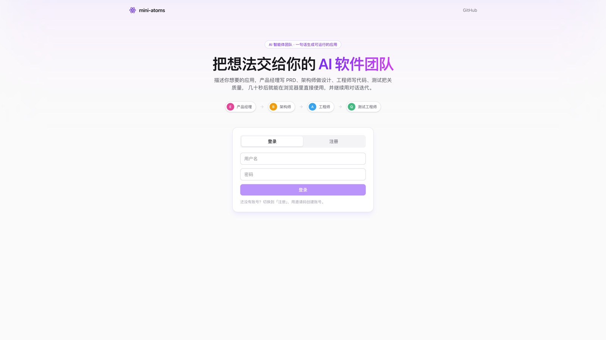

1. 打开线上地址，切换到「注册」。
2. 填写用户名（3-32 位字母、数字或下划线）、密码（至少 6 位）和邀请码。邀请码用于控制模型调用成本，由作者在笔试文档中提供。
3. 注册后自动进入；以后用同一个账号在任何设备上登录，都能看到自己的项目。

如果模型服务暂时不可用（网关连不上、额度用尽），这一轮会自动改用「演示模式」：团队回放预置的看板、番茄钟或记账本应用，流程、预览、版本和发布都照常可用，对话区会显示一条提示。服务端没有配置模型 Key 时，右上角会常驻「演示模式」标识。

每个账号有 30 次生成额度，右上角常驻显示剩余次数，点击可进入「用量」页（见第 6 节）。普通生成和每次对话修改消耗 1 次，Race 按参赛模型数消耗（见第 3 节）。

## 2. 生成第一个应用

登录后进入项目页：

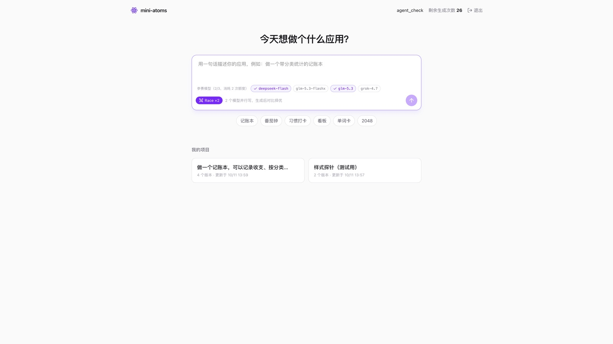

- 在输入框里用一句话描述应用，按 Enter 发送；也可以直接点下方的示例（记账本、番茄钟、习惯打卡、看板、单词卡、2048）。
- 进入工作台后，团队依次工作，左侧对话区实时显示每个角色的输出：

| 角色 | 职责 |
| --- | --- |
| Emma · 产品经理 | 把一句话需求写成 PRD：目标、核心功能、页面交互、需要保存的数据 |
| Bob · 架构师 | 设计文件结构、状态和数据流 |
| Alex · 工程师 | 按 PRD 和架构写出多文件 React 应用，右侧实时显示正在写的代码 |
| Quinn · 测试工程师 | 静态检查入口、依赖、文件引用、图标名、导入导出；有问题会交回 Alex 自动修一轮 |
| Mike · 团队负责人 | 有应用之后，判断你的新消息是"在现有应用上修改"还是"推倒重做" |

完成后右侧自动切到「预览」，生成的应用可以直接操作，数据保存在浏览器的 localStorage 里，刷新不会丢。

## 3. Race：多个模型同台比拼（亮点功能）

同一个需求交给 2-3 个模型并行实现，生成后对比效果，挑最好的一版。

**怎么用**

1. 在项目页或对话框里点「Race」开关，下方出现参赛模型列表。
2. 勾选 2-3 个模型（可选 deepseek-flash、glm-5.3-flashx、glm-5.3、grok-4.7），会记住你上次的选择。
3. 发送需求。Emma 和 Bob 只跑一次，各模型基于同一份 PRD 和架构并行写代码，工作台分栏实时显示每个模型的进度、正在写的文件和思考过程：

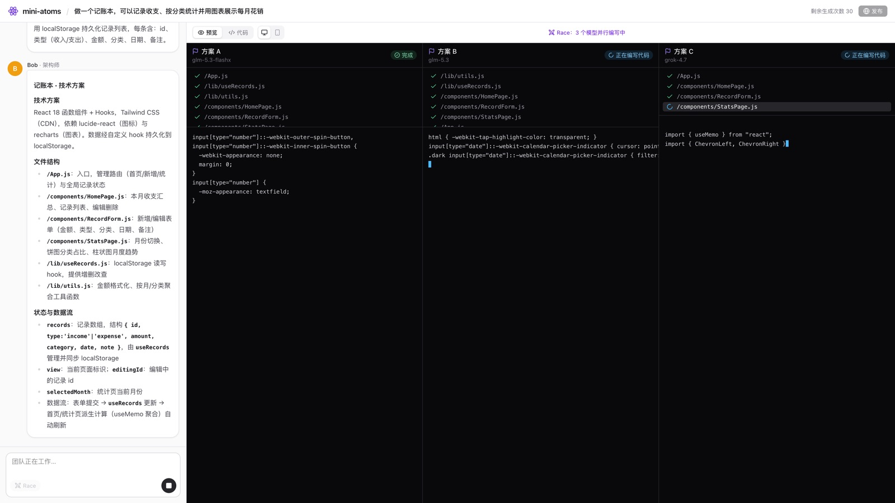

4. 全部完成后，顶部出现方案切换条。点「方案 A / B / C」切换预览，满意就点「采用」，会生成一个新的正式版本：

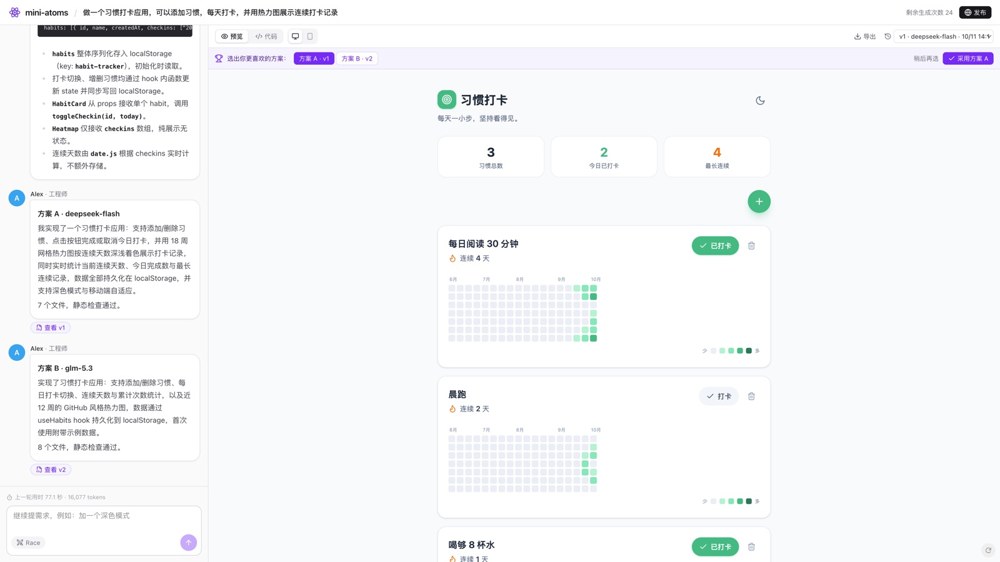

**说明**

- Race 只在新建应用或推倒重做时生效；对现有应用的小修改不会触发 Race，也不会多扣额度。
- 额度按参赛模型数计算，3 个模型消耗 3 次。额度不足时会自动退回单方案生成并提示。
- 每个候选方案都会保存为一个版本（版本列表里标有模型名）。即使没有当场采用，之后也能在版本列表里找到并回滚。
- 线上实测：3 模型 Race（记账本）用时 88 秒、约 3.1 万 tokens；2 模型 Race（习惯打卡）用时 77 秒、约 1.6 万 tokens。

下图是 grok-4.7 生成的记账本：

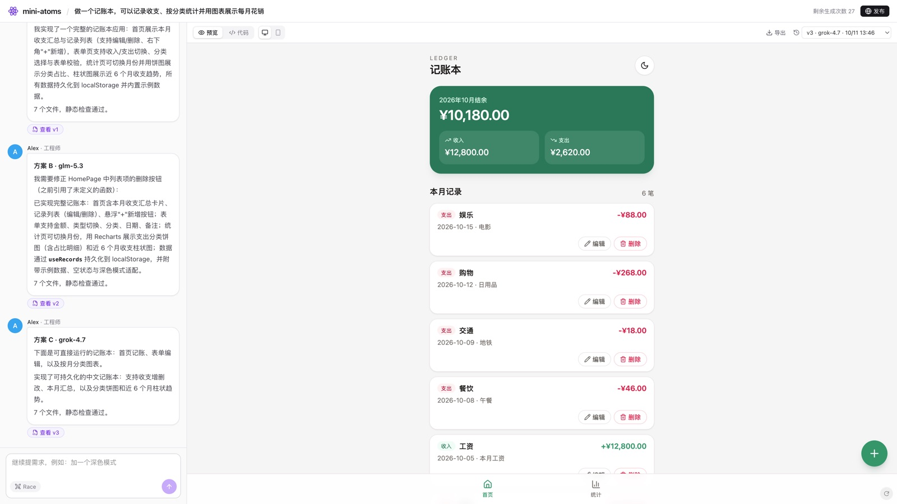

## 4. 继续迭代

在左侧对话框继续提需求即可，例如"把主题色从绿色改成紫色""加一个深色模式""统计页加一个月份选择"。

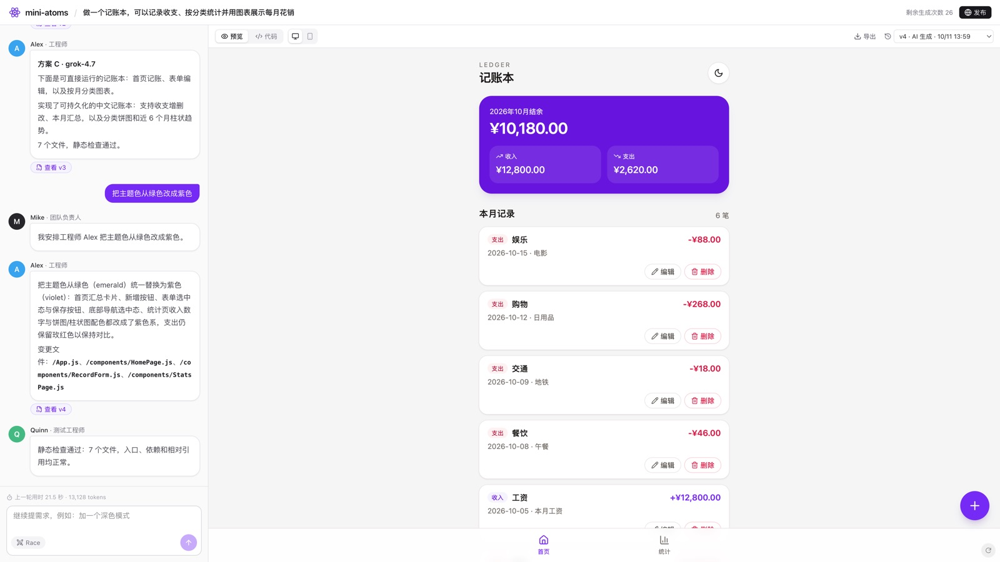

- Mike 判断这是修改还是重做；修改时 Alex 只改相关文件，Quinn 检查后生成新版本。上图这次修改用时 21.5 秒。
- **版本历史**：右上角下拉框列出所有版本（AI 生成、Race 候选、手动编辑、回滚），可以切换查看，点「回滚到此版本」恢复。历史版本永远不会丢。
- **手动改代码**：切到「代码」页签直接编辑，预览实时刷新，点「保存为新版本」保存。
- **一键修复**：预览运行报错时，底部会出现「让 Alex 修复」按钮，把报错交给工程师处理。
- 对话框上方显示上一轮的耗时、token 用量和各角色消耗的 token；点「查看明细」可以看到这一轮每个智能体的执行时间线（见第 6 节）。

## 5. 发布与分享

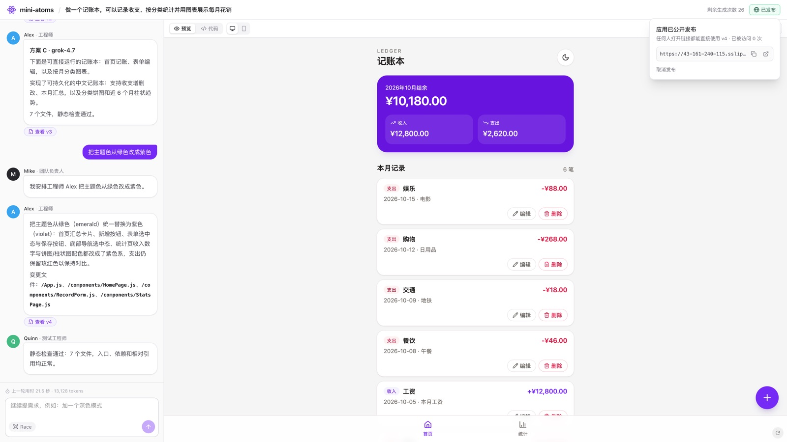

1. 点右上角「发布」，再点弹层里的「发布」，得到一个公开链接 `/s/xxxx`。
2. 任何人无需登录就能打开并使用这个应用。弹层里能看到累计访问次数，以及近 7 天的每日访问、访问来源（例如从哪个网站点进来）和桌面 / 手机占比。
3. 发布的是某个版本的快照：之后继续修改不会影响已发布的内容。有新版本时，弹层里会出现「更新到最新版本」。
4. 可以随时「取消发布」，链接立即失效。

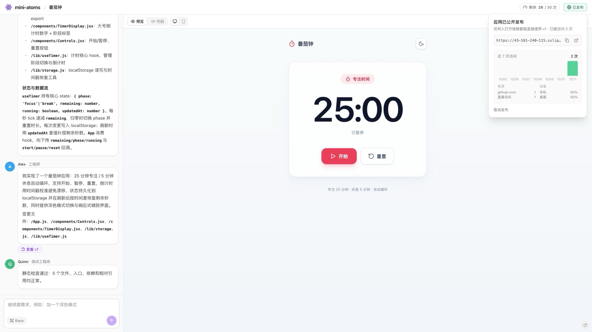

访客看到的分享页（全屏运行，左下角有 mini-atoms 标识）：

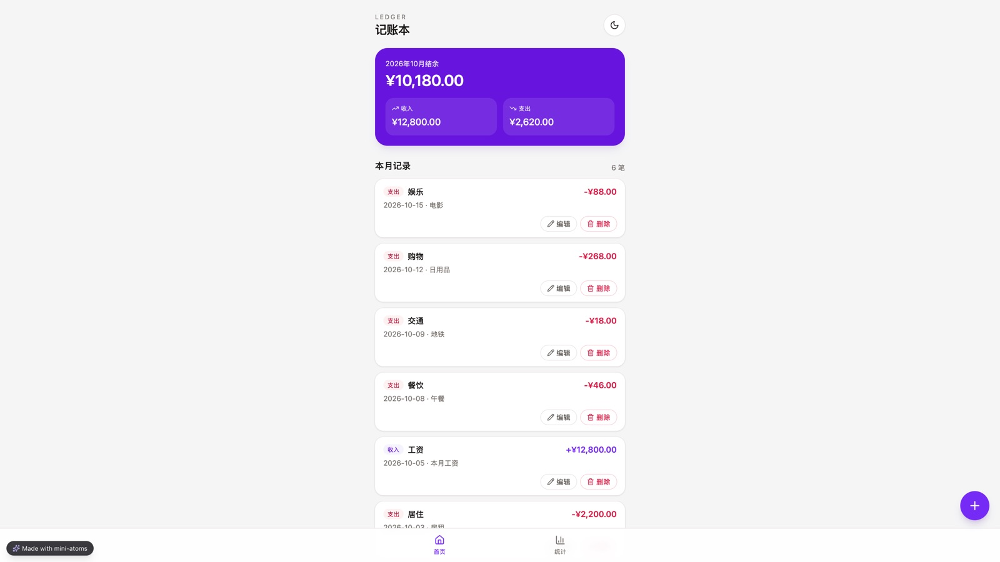

线上示例：<https://43-161-240-115.sslip.io/s/tzxNG8ml>

## 6. 用量、运行明细与服务状态

**每轮运行明细**

每轮生成结束后，对话框上方会显示耗时、token 和各角色的 token。点「查看明细」打开时间线：

- 每一次模型调用一行：哪个智能体、用的哪个模型、在这一轮里的起止时间（横条）、首字延迟（等模型吐出第一个字的时间）、耗时、输入 / 输出 token。
- 点开一行可以看模型的思考过程和完整输出；Quinn 修复轮、格式重试、Race 的各个方案会单独标出。
- 顶部是这一轮的整体结果：成功 / 失败 / 中断、新建还是修改、总耗时、静态检查是否通过。

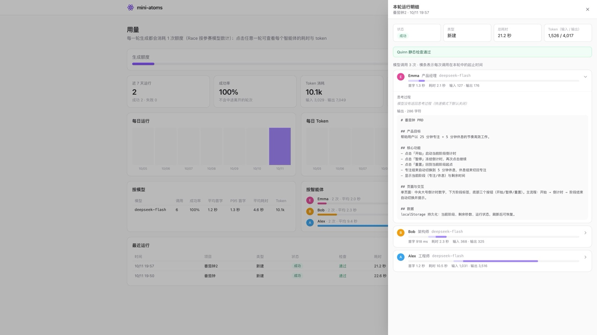

上图是线上一轮"番茄钟"新建：总耗时 21.2 秒，Emma 2.1 秒、Bob 2.3 秒、Alex 10.5 秒，首字延迟都在 1.3 秒以内；输入 1526、输出 4017 token。普通用户的明细里看得到思考过程和输出，看不到发给模型的提示词。

**用量页**

点右上角的剩余次数进入「用量」页，可以切换近 7 天 / 近 30 天：

- 额度已用和剩余；运行次数、成功率、token 消耗、耗时中位数和 P95。
- 每日运行和每日 token 趋势；按模型（调用次数、成功率、首字延迟、耗时、token）和按智能体（token 占比）拆分。
- 最近 20 轮运行，点任意一行打开它的明细。

中途关闭页面的轮次记为「中断」，不计入失败。

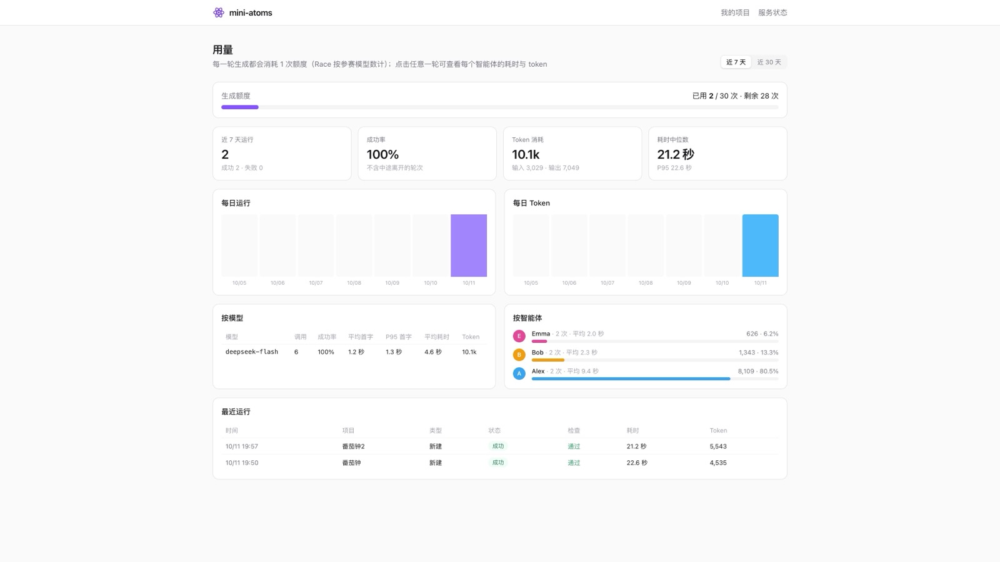

**服务状态**

<https://43-161-240-115.sslip.io/status> 无需登录，每 30 秒自动刷新（登录页底部也有入口）：

- 应用服务、数据库、模型网关三个组件是否正常，以及响应时间。
- 近 24 小时的生成次数、成功率、每小时成功 / 失败分布、单轮耗时中位数。
- 各模型近 24 小时的调用成功率和平均首字延迟，以及当前部署的版本号。

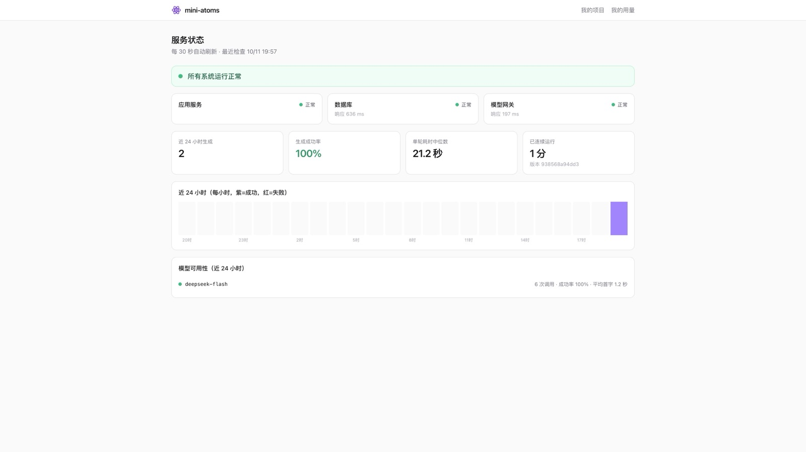

数据库不可用时显示「服务中断」；模型网关不可用，或近 24 小时成功率低于 80% 时显示「部分服务性能下降」。

**运营后台（仅管理员）**

管理员账号在项目页右上角会看到「运营」入口（`/admin`）：用户 / 项目 / 运行量、成功率、耗时、token 趋势，模型健康度，各智能体 token 占比，生成质量（静态检查通过率、需要修复的比例、Race 采用情况），活跃用户、额度预警、邀请码使用、热门分享。运行记录可以按状态、模型、用户筛选，打开后能看到发给模型的完整提示词。普通用户的明细里不包含提示词。

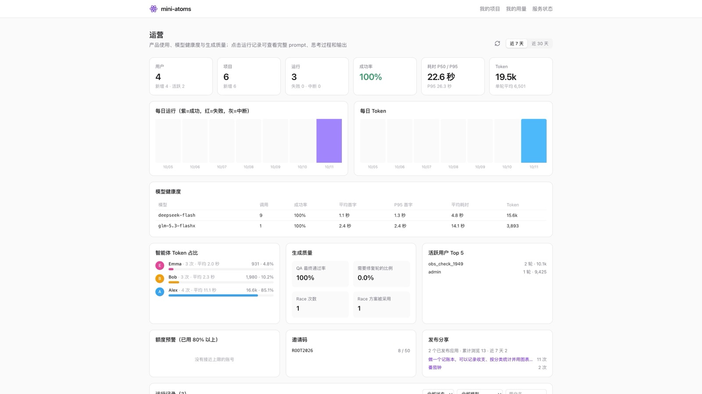

下图是在运营后台按模型筛选出的一轮 2 模型 Race（习惯打卡，26.3 秒、9425 token）：Emma、Bob 只跑一次，两个方案的 Alex 并行编写，展开后能看到发给 glm-5.3-flashx 的 system 和 user 提示词。

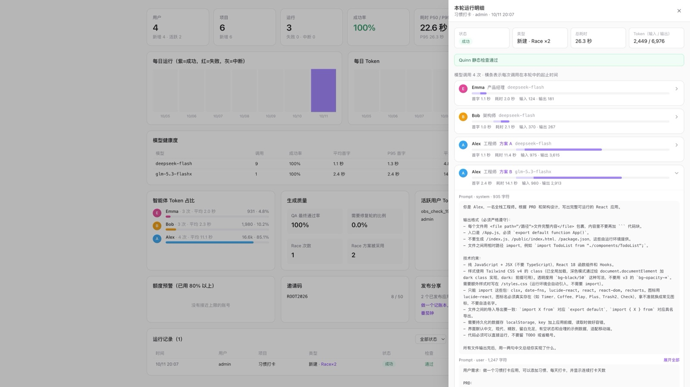

## 7. 其他功能

- **手机尺寸预览**：预览页签旁的手机图标，可以按 390px 宽度查看移动端效果。

  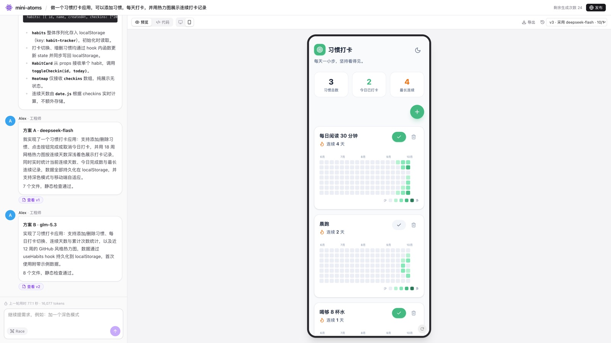

- **导出项目**：点「导出」下载 zip，解压后执行 `npm install && npm start` 就能在本地运行（标准 Create React App 结构）。
- **导出 HTML**：点「HTML」下载单个 HTML 文件，双击就能在浏览器里打开使用，不需要安装和构建（React 等依赖从 esm.sh 加载，需要联网）。
- **手机上使用工作台**：窄屏下工作台顶部会出现「对话 / 应用」切换。

## 8. 常见问题

**预览一直在加载或空白？**
预览由 CodeSandbox 的浏览器打包服务编译，首次加载需要几秒到十几秒。网络不稳定时可以点预览右下角的刷新按钮。如果预览显示 `Could not find module ...` 之类的加载错误，多半是打包服务偶发故障，点刷新重试即可，分享页同样有刷新按钮。

**生成的应用数据存在哪里？**
存在你浏览器的 localStorage 里，按应用隔离。换浏览器或清除浏览器数据后，应用里的数据会重置（项目、对话和代码版本存在服务器上，不受影响）。

**能生成带后端、数据库的应用吗？**
暂不支持，目前生成的是纯前端 React 应用。这是后续路线中优先级最高的产品功能，详见 README。

**为什么 Race 的某一栏报错了？**
某个模型调用失败只会影响它自己那一栏，其他方案照常产出，可以从成功的方案里挑选。如果某个模型没有产出代码（输出为空或被截断），那一栏会显示「工程师没有产出代码」。

**为什么有些轮次的 token 显示为 0？**
token 数由模型服务在响应里返回，个别模型或网关不返回时只记录耗时。

**刷新页面后方案对比条不见了？**
对比条只在本次生成结束时显示；刷新后各候选方案仍在版本列表里（标有模型名），选中后可以回滚成正式版本。
