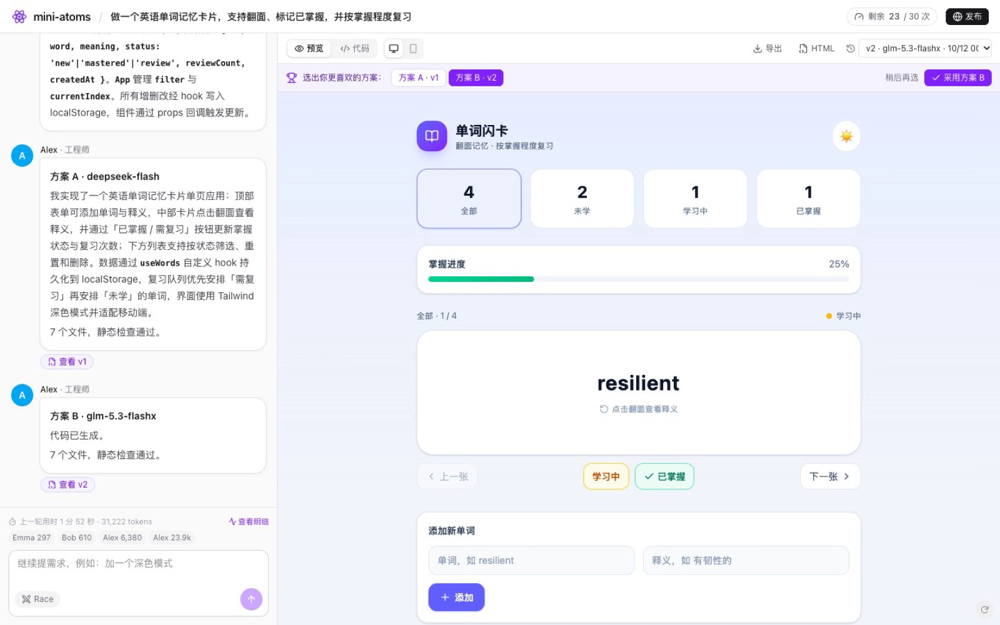
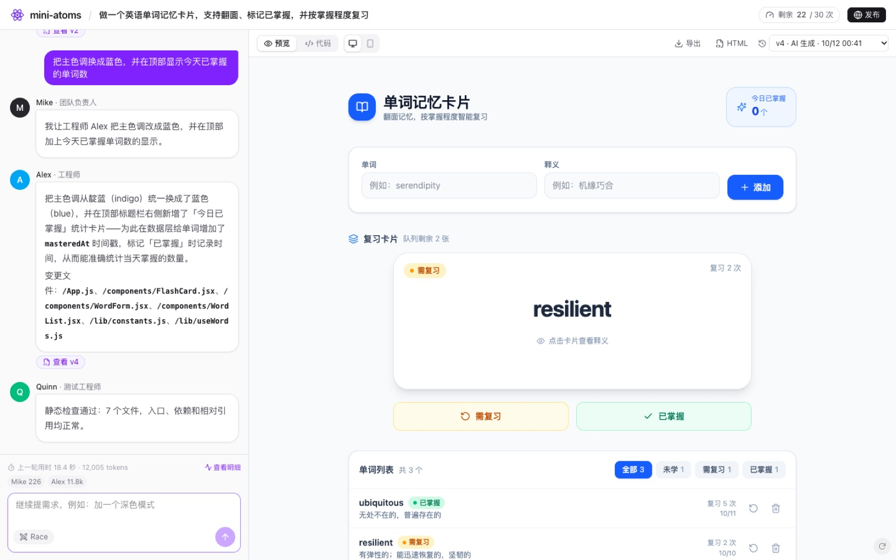
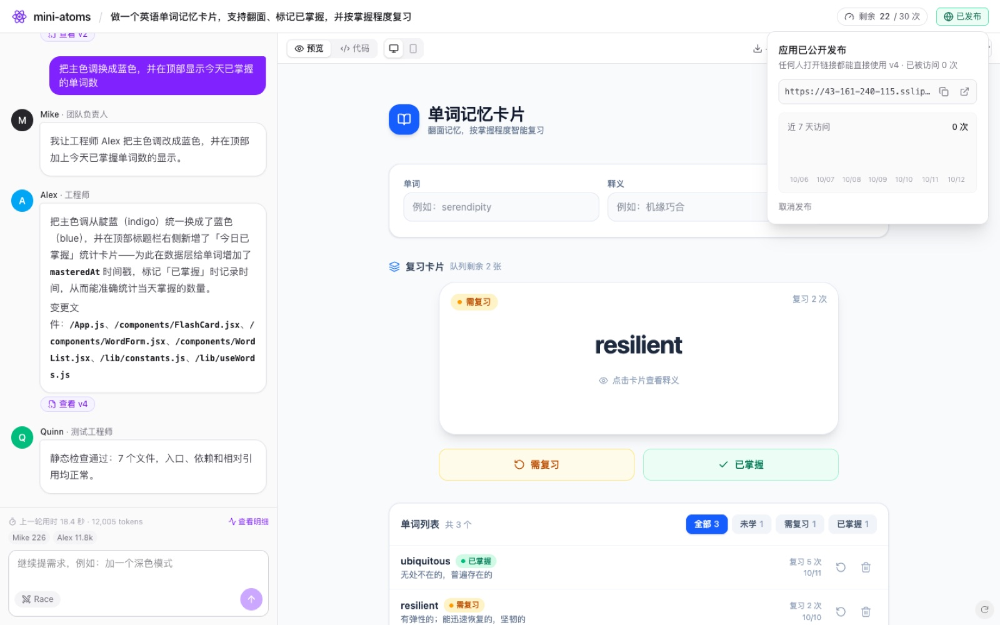
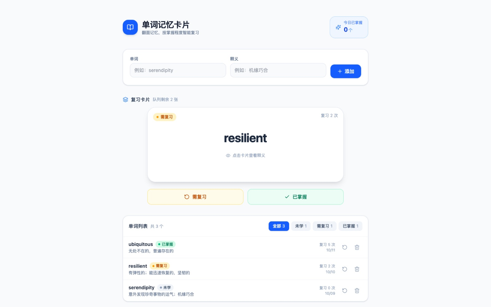
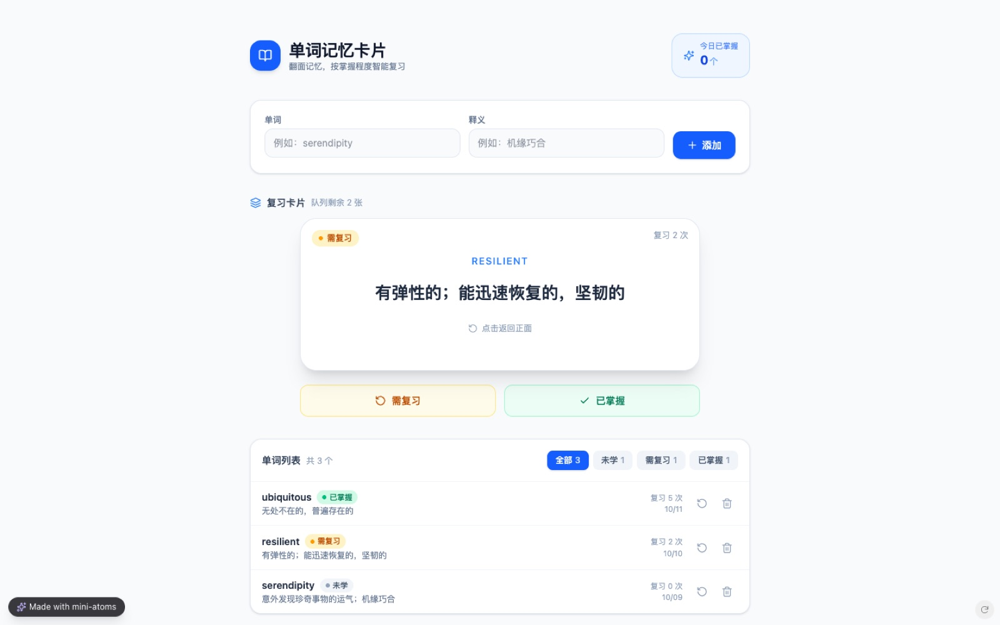
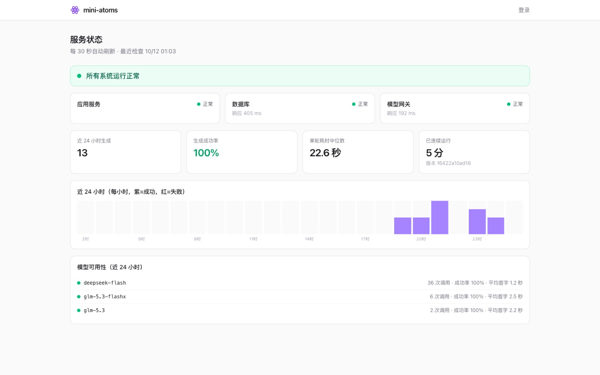

# 演示走查（图文）

用一次完整的线上操作，展示 mini-atoms 从一句话到可分享应用的全过程。截图和数据都来自线上环境（2026-10-12，真实模型），和 [演示视频](https://github.com/zh-Spike/mini-atoms/releases/download/demo-2026-10-11/mini-atoms-demo.mp4)（2 分 57 秒）是同一次操作。想自己动手，按 README 里的「评审快速体验」操作即可。

## 已发布的示例作品（免登录）

| 作品 | 链接 | 怎么来的 |
| --- | --- | --- |
| 单词卡 | <https://43-161-240-115.sslip.io/s/YfCiV50y> | 本文和演示视频中生成：Race（deepseek-flash 对 glm-5.3-flashx），采用方案 A，再用一句话迭代 |
| 番茄钟 | <https://43-161-240-115.sslip.io/s/di8saYac> | Race（deepseek-flash 对 glm-5.3），采用方案 A，再用一句话迭代成蓝色主题 |
| 习惯打卡 | <https://43-161-240-115.sslip.io/s/9_oQDh5p> | Race（deepseek-flash 对 glm-5.3-flashx），采用后加深色模式切换 |
| 看板 | <https://43-161-240-115.sslip.io/s/7YEOxY_5> | 一句话生成，21 秒，静态检查一次通过 |
| 记账本 | <https://43-161-240-115.sslip.io/s/RGa9mbuC> | 一句话生成，29 秒，静态检查一次通过 |

这些链接打开后，应用在浏览器沙箱里编译运行（首次加载打包服务需要几秒），可以直接使用；应用数据存在访问者自己的浏览器里，刷新后仍在。

## 1. 输入一句话

在项目页写一句需求，或点下方的示例。打开 **Race** 后会出现参赛模型，勾选 2-3 个；这里用默认的 deepseek-flash 和 glm-5.3-flashx，点示例「单词卡」。

## 2. 团队协作，Race 并行写代码

- 左侧对话区：Emma 写出 PRD（目标、核心功能、交互、要持久化的数据），Bob 给出文件结构和数据流。
- 右侧：两个工程师基于同一份 PRD 和架构并行写代码，每路实时显示正在写的文件和代码，写完各自过静态检查。图中方案 A 已经完成，方案 B 还在写。

这一轮用时 111.6 秒、31,222 token：两个方案各 7 个文件，都通过检查。

## 3. 对比两个方案，采用一个

预览上方切换「方案 A / B」，两个方案都能直接操作。图中是方案 B（glm-5.3-flashx）：统计卡片加进度条的布局，和方案 A 的卡片翻面布局不一样。这里采用方案 A。

## 4. 用对话继续修改

发一句「把主色调换成蓝色，并在顶部显示今天已掌握的单词数」：

- Mike 判断这是「在现有应用上修改」，交给 Alex；
- Alex 只输出改动的 6 个文件，与上一版本合并成 v4（为了统计“今天”掌握数，还给数据加了掌握时间）；
- Quinn 再次检查通过。

用时 18.4 秒、12,005 token。右上角的版本列表保留了全部版本（两个 Race 候选、采用版本、迭代版本），可以随时查看和回滚。

## 5. 一键发布

点右上角「发布」，得到公开链接 `/s/{slug}`，并显示近 7 天的访问量。发布的是当前版本的快照，之后继续修改不会影响已发布的应用，需要手动「更新到最新版本」。

## 6. 导出

预览上方有两个导出按钮：

- 「导出」：Create React App 结构的 zip，`npm install && npm start` 即可本地运行；
- 「HTML」：单个 HTML 文件，双击就能在浏览器里打开使用，不需要安装和构建（React 等依赖从 esm.sh 加载，需要联网）。

下图是导出的 HTML 文件用浏览器直接打开（`file://`）的效果：

## 7. 别人打开分享链接

无需登录，应用全屏运行。下图是访客打开单词卡分享链接、点击卡片翻到背面：

其他示例作品：

手机上同样可用（看板，390 宽）：

## 8. 服务状态

公开的 `/status` 页显示应用、数据库、模型网关三个组件的状态，近 24 小时的生成次数、成功率、耗时，以及各模型的调用成功率和首字延迟。

## 兜底

- **模型不可用时**：如果模型网关连不上或额度用尽，这一轮会自动切到演示模式，团队回放预置的看板、番茄钟或记账本应用，流程、预览、版本和发布都照常可用，对话区会显示一条提示。实现说明见 README「实现思路与关键取舍」第 15 条。
- **预览加载报错时**：预览依赖 codesandbox.io 的打包服务。录制这次演示时，它曾有约 7 分钟间歇性地冷编译失败（连一行代码的应用都失败），之后自行恢复。现在已显式声明它需要的依赖，分享页也加了刷新按钮；万一遇到，点预览右下角的刷新即可。
